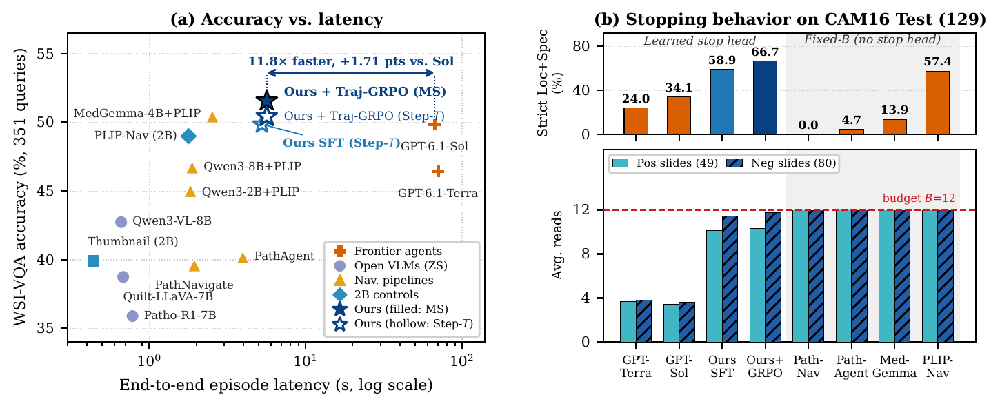
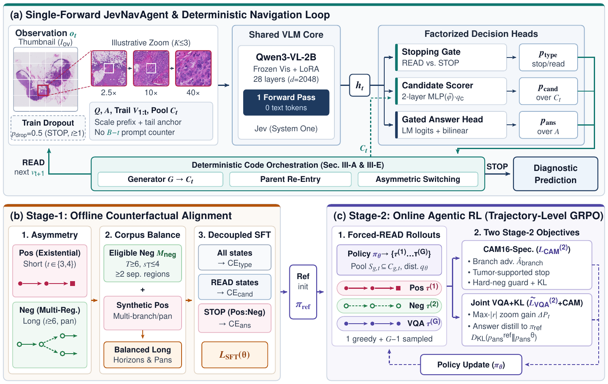
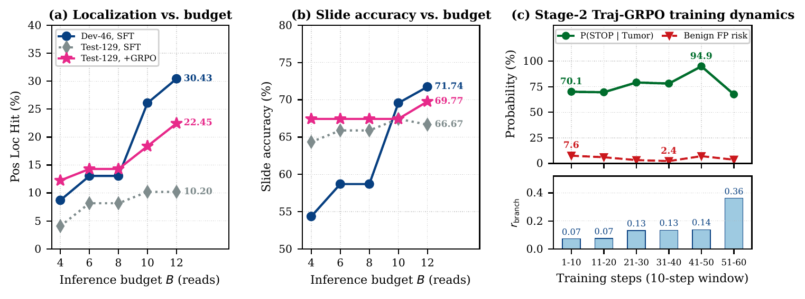
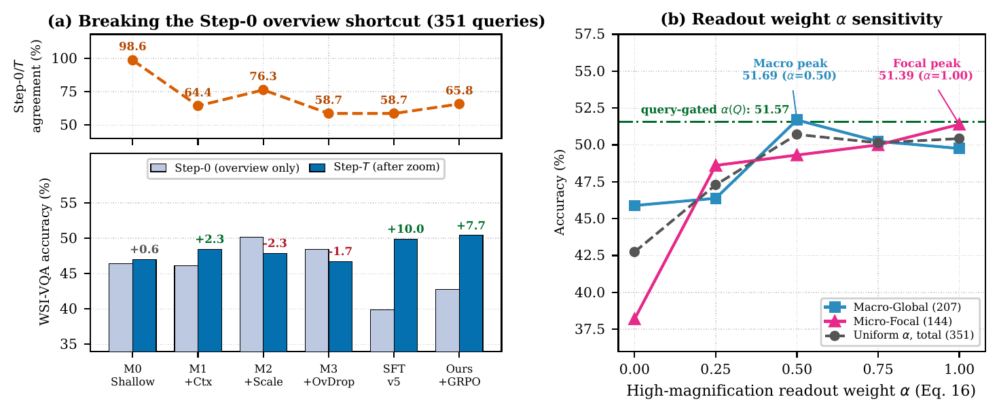
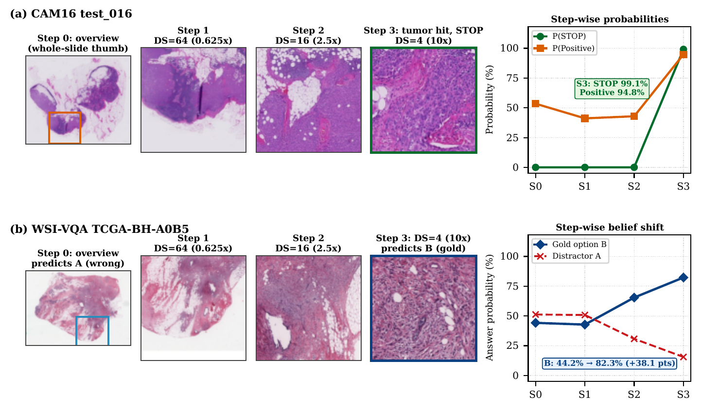

<div align="center">

# JevNavAgent: A Single-Forward Visual Navigation Agent with Trajectory-Level RL for Gigapixel Pathology

**Yonghuang Wu**, **Zhenyang Liang**, **Pengfei Wang**, **Yize Ma**, **Guoqing Wu**, and **Jinhua Yu**

*School of Biomedical Engineering and Technological Innovation, Fudan University, Shanghai, China*  
Contact: `yonghuangwu21@m.fudan.edu.cn`

[](https://huggingface.co/datasets/renyimen/JevNavAgent)
[](https://huggingface.co/renyimen/JevNavAgent)
[](LICENSE)

</div>

---

## Overview

Gigapixel whole-slide images (WSIs) routinely exceed $100{,}000 \times 100{,}000$ pixels at $40\times$ magnification, making single-pass vision-language models (VLMs) blind to cellular detail and offline multiple instance learning (MIL) unable to perform interactive, query-conditioned inspection.

**JevNavAgent** builds on the **Jev (System One)** paradigm: a compact **2B-parameter** VLM (`Qwen3-VL-2B-Instruct` + LoRA) maps the multimodal navigation state directly to factorized probability distributions over **stopping**, **spatial-candidate selection**, and **contextual-bilinear answering** in a **single forward pass (0 generated tokens)**, while deterministic code executes the multi-scale zoom/pan pyramid ($\mathcal{S} = \{64, 16, 4, 1\}$, $0.625\times\text{--}40\times$).

<p align="center">
  
</p>

> **Figure 1.** *(a)* On **Clean Visual WSI-VQA (351 questions)**, `JevNavAgent + Traj-GRPO` achieves **51.57%** multi-scale (**50.43%** Step-$T$) overall accuracy and **51.39%** Micro-Focal accuracy at **5.63 s/episode** — nearly **12× faster** than frontier multi-turn API agents (`66.64–70.04 s`). *(b)* On **CAMELYON16 Official Test (129 WSIs, $B=12$)**, `JevNavAgent + Traj-GRPO` learns clinically asymmetric stopping (`10.29` reads on positive vs. `11.75` reads on negative slides), achieving **67.44%** Strict Loc+Spec (Online) and **22.45%** Pos Loc Hit / **93.75%** Spec / **69.77%** Slide Acc (Calib.).

### Method Architecture & Two-Stage Training

<p align="center">
  
</p>

> **Figure 2.** **(1) Single-Forward Navigation Agent**: three factorized decision heads (evidence-sufficiency stopping, spatial-geometry candidate scoring, and gated contextual-bilinear answering) paired with physical magnification context and overview modality dropout. **(2) Stage-1 Counterfactual Trajectory Alignment**: 1:1 horizon- and scale-aligned positive/negative stopping supervision and DAgger recovery trajectories across 449 active training WSIs (`16,635` transitions). **(3) Stage-2 Online Trajectory-Level GRPO (`Traj-GRPO`)**: decoding-free online rollouts on a single GPU optimizing branch-level lesion discovery, in-polygon stopping against hard-negative follicles, and step-wise answer confidence gain ($\Delta P_t$) under a soft KL lock.

---

## Key Experimental Results

### 1. Clean Visual WSI-VQA (`351` Held-Out Questions: `179` Val + `172` Test, `153` Unseen WSIs)

| Category | Method | Params | Val | Test | **Total** | Macro-Global | **Micro-Focal** | Clin. A–D | Reads | Time (s) |
| :--- | :--- | :---: | :---: | :---: | :---: | :---: | :---: | :---: | :---: | :---: |
| *Frontier Agents* | GPT-6.1-Terra | Frontier | 41.90 | 51.16 | 46.44 | 52.17 | 38.19 | 45.61 | 3.33 | 70.04 |
| *Frontier Agents* | GPT-6.1-Sol | Frontier | 48.60 | 51.16 | 49.86 | **53.14** | 45.14 | 50.00 | 2.69 | 66.64 |
| *Open VLMs (ZS)* | Patho-R1-7B | 7B | 32.96 | 38.95 | 35.90 | 36.71 | 34.72 | 33.78 | 0.00 | 0.78 |
| *Open VLMs (ZS)* | Quilt-LLaVA-7B | 7B | 37.99 | 39.53 | 38.75 | 34.78 | 44.44 | 36.15 | 0.00 | 0.68 |
| *Open VLMs (ZS)* | Qwen3-VL-8B | 8B | 40.22 | 45.35 | 42.74 | 48.79 | 34.03 | 41.22 | 0.00 | 0.66 |
| *Competing Nav* | PathNavigate | 7B | 36.31 | 43.02 | 39.60 | 38.65 | 40.97 | 38.51 | 2.98 | 1.94 |
| *Competing Nav* | PathAgent | 11B | 37.99 | 42.44 | 40.17 | 47.34 | 29.86 | 39.19 | 2.98 | 3.96 |
| *Competing Nav* | Qwen3-VL-8B + PLIP | 8B | 44.13 | 49.42 | 46.72 | 51.69 | 39.58 | 44.93 | 2.98 | 1.88 |
| *Competing Nav* | MedGemma-4B + PLIP | 4B | 50.28 | 50.58 | 50.43 | **53.14** | 46.53 | 51.35 | 2.98 | 2.53 |
| **Ours (Stage-1)** | **JevNavAgent (SFT, 2B)** | **2B** | 50.84 | 48.84 | 49.86 | 50.24 | 49.31 | 53.38 | 3.09 | 5.25 |
| **Ours (Stage-2)** | **JevNavAgent + Traj-GRPO (Step-T)** | **2B** | 50.84 | 50.00 | 50.43 | 49.76 | **51.39** | 53.38 | 3.05 | 5.63 |
| **Ours (Stage-2)** | **JevNavAgent + Traj-GRPO (Multi-Scale)** | **2B** | **51.40** | **51.74** | **51.57** | 51.69 | **51.39** | **54.73** | 3.05 | 5.63 |

### 2. Exhaustively Verified CAMELYON16 Official Test (`129` WSIs: `49` Pos / `80` Neg, Budget `B=12`)

| Method | Pos Loc Hit | Visited Hit | Stop Conv. | Neg Spec | **Strict Loc+Spec** | **Slide Acc** | Pos / Neg Reads |
| :--- | :---: | :---: | :---: | :---: | :---: | :---: | :---: |
| JevNavAgent (SFT, 2B) | 10.20 | 22.45 | 45.5% | 88.75 | 58.91 | 66.67 | 10.16 / 11.45 |
| **JevNavAgent + Traj-GRPO (Online)** | 16.33 | **24.49** | 66.7% | **98.75** | **67.44** | 68.99 | 10.29 / 11.75 |
| **JevNavAgent + Traj-GRPO (Calib.)** | **22.45** | **24.49** | **91.7%** *(11/12)* | 93.75 | 66.67 | **69.77** | 10.29 / 11.75 |

### 3. Test-Time Budget Scaling, Zoom Evidence Integration & Qualitative Trajectories

<p align="center">
  
  
</p>

> **Figures 3 & 4.** *(Left)* Zero-shot test-time budget scaling over $B \in \{4,6,8,10,12\}$ and online `Traj-GRPO` training dynamics. *(Right)* Removing thumbnail rigidity: Step-0/Step-$T$ agreement drops from `98.58%` (`M0`) to `58.69%` (`SFT v5`) with `+35` net zoom flips (`+27` for `Traj-GRPO`, `42.74% -> 50.43%`), and query-gated multi-scale readout lifts overall accuracy to `51.57%`.

<p align="center">
  
</p>

> **Figure 5.** Qualitative multi-scale navigation trajectories: *(a)* `CAMELYON16` micrometastasis localization (`test_016`, `DS = 64 -> 16 -> 4`, $P(\text{STOP}): 0.1\% \to 99.1\%$, $P(\text{Pos}): 53.5\% \to 94.8\%$); *(b)* `WSI-VQA` focal diagnosis (`TCGA-BH-A0B5`, gold option confidence rising from `44.2%` at overview to `82.3%` after zooming into $10\times$).

---

## Installation

Requires Python 3.10+ and system OpenSlide (`sudo apt-get install -y openslide-tools libopenslide0` on Ubuntu/Debian):

```bash
git clone https://github.com/yonghongwu/JevNavAgent.git
cd JevNavAgent
pip install -e ".[dev]"
```

---

## Download Benchmark Metadata & Whole-Slide Images

Curated manifests, visual-grounding audit ledgers, CAMELYON16 XML polygon masks, counterfactual trajectories (`formal_terra_v5_train.parquet`), and official baseline predictions are hosted on HuggingFace at [`renyimen/JevNavAgent`](https://huggingface.co/datasets/renyimen/JevNavAgent):

```bash
# 1. Download metadata, XML annotations, counterfactual trajectories & baseline predictions (~107 MB)
jevnav-download --mode metadata --out ./data

# 2. Download evaluation WSIs directly from NIH GDC & CAMELYON16 S3 (with resume + MD5 check)
jevnav-download --mode eval-slides --out ./data --workers 4

# (Optional) Download full training + evaluation WSIs
jevnav-download --mode full --out ./data --workers 4
```

---

## Evaluate Your Own Model or API (Pluggable Interface)

### Option A: Score Official Baseline Predictions Immediately (No WSI Download Needed)

```bash
jevnav-score \
  --benchmark wsivqa_351 \
  --manifest ./data/manifests/wsivqa_clean_visual_val_179.json ./data/manifests/wsivqa_clean_visual_test_172.json \
  --predictions ./data/baseline_predictions/wsivqa_351/jevnav_traj_grpo_vqa_kl_B4.jsonl
```

### Option B: Evaluate Any OpenAI-Compatible Vision API (Zero Code)

Plug in GPT-4o, Claude/Gemini proxies, or any local vLLM/SGLang VLM server:

```bash
jevnav-eval \
  --benchmark wsivqa_351 \
  --policy openai_api \
  --api-base https://api.openai.com/v1 \
  --api-key "$OPENAI_API_KEY" \
  --api-model gpt-4o \
  --data-dir ./data \
  --budget 4 \
  --output results/gpt4o_wsivqa351.jsonl
```

### Option C: Plug In Your Own Local Python Policy

Subclass `BaseWSINavPolicy` and implement `act(obs: NavigationObservation) -> NavigationAction` (see [`examples/custom_policy_template.py`](examples/custom_policy_template.py)):

```bash
jevnav-eval \
  --benchmark wsivqa_351 \
  --policy examples/custom_policy_template.py:MyCustomPathologyPolicy \
  --data-dir ./data \
  --output results/my_policy.jsonl
```

### Option D: Evaluate Pretrained `JevNavAgent` Checkpoints from HuggingFace

```bash
# Stage-2 Traj-GRPO (VQA+KL) on Clean Visual WSI-VQA
jevnav-eval \
  --benchmark wsivqa_351 \
  --policy jevnav \
  --checkpoint renyimen/JevNavAgent:stage2_traj_grpo_vqa_kl \
  --backbone Qwen/Qwen3-VL-2B-Instruct \
  --data-dir ./data \
  --output results/jevnav_vqa.jsonl

# Stage-2 Traj-GRPO (CAM16) on Verified CAMELYON16 Test-129
jevnav-eval \
  --benchmark cam16_test \
  --policy jevnav \
  --checkpoint renyimen/JevNavAgent:stage2_traj_grpo_cam16 \
  --backbone Qwen/Qwen3-VL-2B-Instruct \
  --data-dir ./data \
  --budget 12 \
  --output results/jevnav_cam16_test129.jsonl
```

---

## Training on the Counterfactual Trajectory Corpus

Load `formal_terra_v5_train.parquet` (`16,635` transitions across `449` active training WSIs) directly in Python or launch Stage-1 SFT:

```python
from jevnav.data import CounterfactualTrajectoryDataset

ds = CounterfactualTrajectoryDataset("./data/trajectories/formal_terra_v5_train.parquet")
print(len(ds), ds[0]["slide_id"], ds[0]["target"])
```

```bash
jevnav-train-sft \
  --train-data ./data/trajectories/formal_terra_v5_train.parquet \
  --backbone Qwen/Qwen3-VL-2B-Instruct \
  --output-dir ./runs/jevnav_sft_repro
```

---

## Roadmap (`v2.0` Multi-Organ Benchmark Expansion)

This `v1.0-Breast` release establishes the unified active navigation environment and evaluation protocol across breast pathology (`TCGA-BRCA` + `CAMELYON16`). Upcoming `v2.0` subsets will expand to additional organ systems and specimen geometries (prostate needle biopsies, colorectal resections, and non-small-cell lung cancer) under the same `jevnav` interface.

---

## Citation

If you find **JevNavAgent**, the **Clean Visual WSI-VQA / Verified CAMELYON16** benchmarks, or the **Counterfactual Trajectory Corpus** helpful in your research, please cite:

```bibtex
@article{wu2026jevnavagent,
  title   = {JevNavAgent: A Single-Forward Visual Navigation Agent with Trajectory-Level RL for Gigapixel Pathology},
  author  = {Wu, Yonghuang and Liang, Zhenyang and Wang, Pengfei and Ma, Yize and Wu, Guoqing and Yu, Jinhua},
  journal = {arXiv preprint},
  year    = {2026},
  note    = {Code and benchmark available at https://github.com/yonghongwu/JevNavAgent}
}
```

## License

Code, curated manifests, audit ledgers, and counterfactual trajectory annotations are released under the **Apache-2.0 License**. Underlying whole-slide images remain governed by their original public licenses (NIH GDC TCGA-BRCA Open Access and CAMELYON16 CC0).
